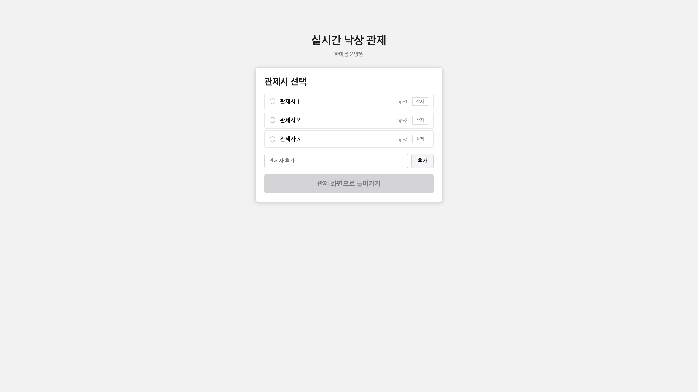
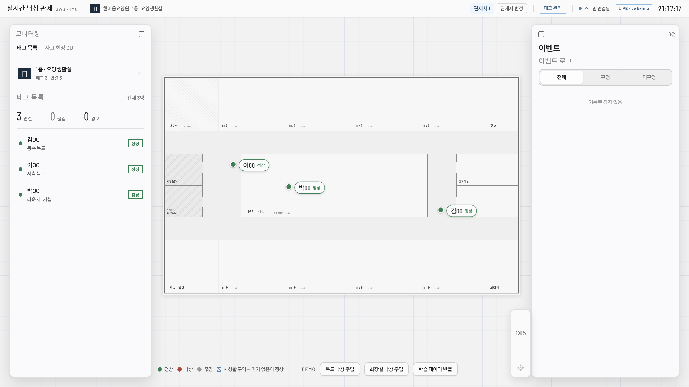
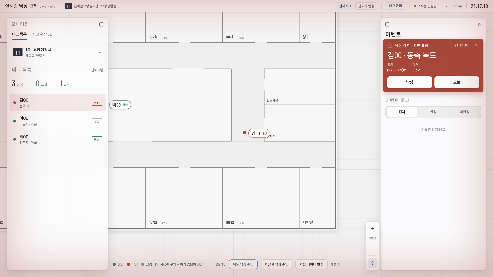
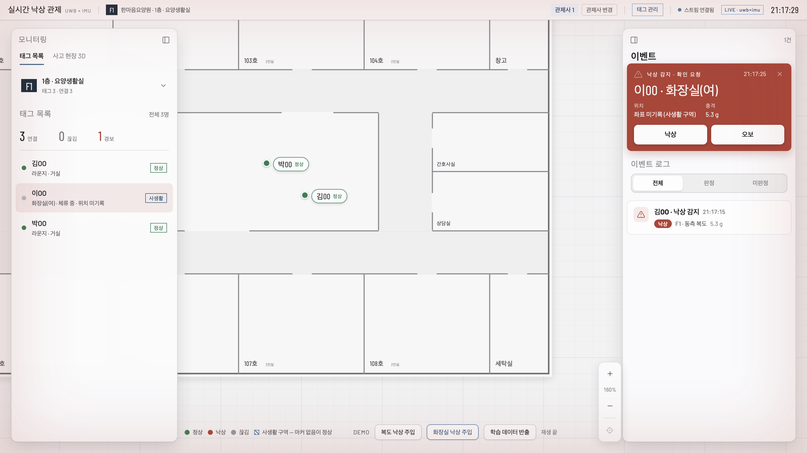
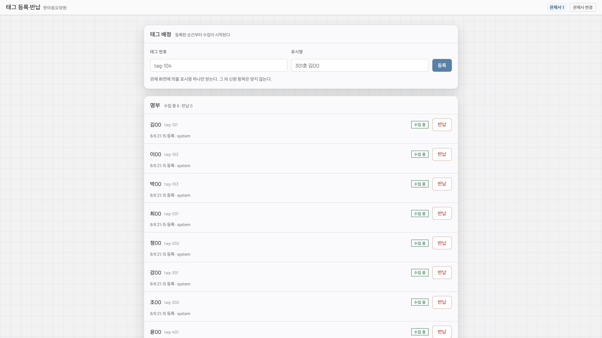
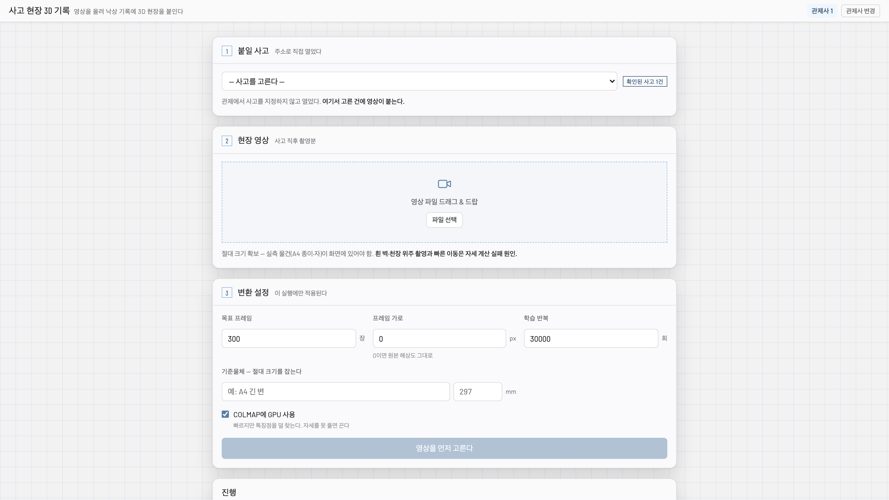

# 착용형 UWB 실내 낙상 관제 시스템

> 본 프로젝트는 macOS(Apple Silicon)에서 개발하고 검증하였다. 이 문서의 명령도 macOS 기준으로 적는다.

노인요양시설을 대상으로 하는 실내 위치·낙상 관제 시스템이다. 대상자가 착용한 태그가 UWB로 실내 위치를 측정하고 내장 가속도계로 낙상을 감지하며, 관제사는 브라우저 화면에서 이를 확인한다. 카메라를 사용하지 않으므로 CCTV를 설치할 수 없는 구역까지 포함할 수 있으며, 사생활 보호가 필요한 구역에서는 위치를 기록하지 않고 낙상만 감지한다.

---

## 1. 의존성 설치

동봉된 스크립트가 점검과 설치를 대신한다. 여러 번 실행해도 되며, 이미 갖춰진 것은 건너뛴다.

```
./setup.sh                 필수를 점검하고, 없으면 물어본 뒤 설치한다
./setup.sh --check         아무것도 설치하지 않고 상태만 본다
./setup.sh --with-recon    3D 재구성 도구까지 함께 처리한다
```

아래는 그 스크립트가 하는 일을 손으로 할 때의 절차다.

### 1.1 Node.js 22.18 이상 (필수)

설치할 것은 이것뿐이다. 서버 런타임은 외부 패키지를 사용하지 않으며(Node 내장 HTTP 모듈과 TypeScript 네이티브 실행), 별도의 빌드 단계가 없다. 압축을 해제한 뒤 `npm install` 없이 곧바로 실행된다.

```
brew install node
node --version     # v22.18.0 이상이어야 한다
```

버전이 22.18 미만이면 서버가 기동하지 않는다. `.ts` 파일을 빌드 없이 직접 실행하는 구조인데, 해당 기능(네이티브 타입 스트리핑)이 22.18에서 기본 활성화되었기 때문이다. Node 20 LTS 환경에서는 `ERR_UNKNOWN_FILE_EXTENSION` 오류로 종료된다.

### 1.2 3D 재구성 도구 (선택)

사고 현장 영상을 3D 가우시안 스플랫으로 재구성하는 기능에만 필요하다. **설치하지 않아도 나머지 기능은 모두 동작하며, 3D 화면도 3.6절의 방법으로 확인할 수 있다.**

```
brew install ffmpeg colmap
```

COLMAP은 4.x여야 한다. 4.x에서 GPU 옵션 이름이 변경되었으므로(`--SiftExtraction.use_gpu` → `--FeatureExtraction.use_gpu`), 3.x에서는 첫 단계에서 `unrecognised option` 오류로 중단된다.

**OpenSplat은 동봉하지 않았다.** AGPLv3 라이선스이며, 빌드 산출물이 Apple Silicon과 Metal(MPS) 전용 `arm64` 바이너리로서 libtorch와 OpenCV 등 98개의 동적 라이브러리를 절대 경로로 참조한다(libtorch만 330MB). 다른 환경에 복사하면 실행되지 않으므로 직접 빌드한다.

```
brew install cmake pytorch opencv@4
xcodebuild -downloadComponent MetalToolchain     # Xcode에 기본 포함되지 않는다

git clone https://github.com/pierotofy/OpenSplat.git tools/recon/OpenSplat
mkdir -p tools/recon/OpenSplat/build && cd tools/recon/OpenSplat/build
cmake -DCMAKE_PREFIX_PATH="$(brew --prefix pytorch);$(brew --prefix opencv@4)" \
      -DOpenCV_DIR="$(brew --prefix opencv@4)/lib/cmake/opencv4" \
      -DGPU_RUNTIME=MPS ..
make -j$(sysctl -n hw.logicalcpu)
./opensplat                                       # 사용법이 출력되면 성공이다
```

- **OpenCV는 4를 지정해야 한다.** OpenCV 5는 `calib3d` 모듈이 재편되어 링크가 실패한다(`ld: library 'opencv_calib3d' not found`). 위 `OpenCV_DIR`이 4를 가리키므로 5가 함께 설치되어 있어도 무방하다.
- Metal 툴체인이 없으면 `error: cannot execute tool 'metal'`로 빌드가 중단된다.
- 빌드 로그를 파이프로 넘길 때는 종료 코드를 확인한다. `make ... | tail`은 `tail`의 종료 코드를 반환하므로 실패가 성공으로 보인다.

서버는 `tools/recon/OpenSplat/build/opensplat`을 자동으로 탐색한다. 네 도구 중 하나라도 없으면 기동 배너에 누락 목록을 표시하고 자동 변환을 실행하지 않는다.

---

## 2. 서버 실행

압축을 해제한 디렉터리에서 다음을 실행한 뒤 브라우저로 `http://localhost:8080` 에 접속한다.

```
node server/server.ts --main-anchor-id phoneMain --sub-anchor-id phoneSub --anchor-distance 4 --half-plane positive
```

### 2.1 실행 인자

설정과 달리 실행 인자는 명령줄로 받는다. 실행마다 달라지는 값이자, 틀리면 서버를 띄우면 안 되는 값이기 때문이다. 전체 목록은 `node server/server.ts --help`로 확인한다.

| 인자 | 뜻 |
|---|---|
| `--main-anchor-id` | 원점 (0,0)에 놓인 메인 앵커 ID. 필수 |
| `--sub-anchor-id` | (d,0)에 놓인 서브 앵커 ID. 필수 |
| `--anchor-distance` | 두 앵커 사이 거리 d(미터). 필수 |
| `--half-plane` | 태그가 놓이는 기준선의 반평면(`positive` 또는 `negative`). 필수 |
| `--source` | 측위 소스. `sim`(기본)은 시뮬레이터가 배경 태그를 움직이고, `live`는 실측 ingest만 내보낸다 |
| `--single-anchor-bearing` | 서브 앵커 없이 메인 앵커 거리만으로 좌표를 만드는 시험용 인자 |

앵커 ID 두 개는 `server/map.json`의 같은 층에 선언되어 있어야 한다. **층은 좌표가 아니라 앵커가 결정하므로**, 어느 층에도 없거나 두 층에 걸쳐 있으면 서버가 기동하지 않는다. 잘못된 층이 사고 기록에 기재되면 복구할 수 없기 때문이다. 기동 배너에 층 목록과 실측 앵커가 가리키는 층이 표시된다.

`--source live`로 기동하면 시뮬레이터가 꺼지므로, 실기기나 외부 ingest가 없으면 화면이 비어 있는 것이 정상이다. 태그 명부도 모드마다 파일이 다르다(`registry.sim.json` / `registry.live.json`). 시뮬 배경 태그가 실기기 명부에 "수집 중"으로 남지 않게 하기 위한 것이며, 기동 배너에 어느 명부를 사용하는지 표시된다.

`--single-anchor-bearing`은 거리 하나만으로 좌표를 만들므로 방향이 설정값이다. 측위 정확도의 근거로 쓸 수 없으며, 사용 시 기동 배너와 프레임마다 경고가 남는다.

### 2.2 종료

`Ctrl+C`로 종료한다. 관제 세션은 메모리에만 있으므로 재기동하면 관제사를 다시 선택한다. 서버가 내려가 있던 사이에 교대가 있었는지 알 수 없는데 세션만 남으면, 이전 근무자의 이름으로 오늘의 판정이 기록되기 때문이다.

---

## 3. 기능별 실행 방법

3.1부터 3.4까지는 서버를 기동한 상태에서 순서대로 조작하면 된다. 3.5 이후는 추가 설정이나 준비물이 필요하다.

### 3.1 관제사 식별



첫 접속 시 `/operator` 화면으로 자동 이동한다. 명부에서 관제사를 선택하면 관제 화면이 열린다. 같은 화면에서 관제사를 추가하거나 삭제할 수 있다.

기록을 변경하는 모든 동작(판정, 경보 해제, 태그 등록·반납, 영상 업로드, 수동 파기, 학습 반출)은 관제사 식별 이후에만 허용되며, 세션이 없으면 401을 반환한다. 조회와 측위(`POST /ingest`)는 제한하지 않는다. 식별은 조작의 조건이지 감지의 조건이 아니기 때문이다.

확인자료에 남는 행위자는 이름이 아니라 `op-N` 형식의 식별자이다. 이름 대조는 명부에서 한다.

### 3.2 실시간 관제 화면



관제 화면에서 배경 태그 8명이 층별로 이동한다(F1 3명, F2 2명, F3 2명, F4 1명). 각 태그는 자기 층의 통행 구역 안에서만 이동한다.

- 상단에서 층을 전환한다. 4개 층 각각에 도면이 있다.
- 태그 표시명은 태그 명부에서 가져온다.
- 좌표는 이동평균과 데드밴드를 거쳐 화면에 그려진다. 정지 중에는 한 점에 고정되고, 이동으로 판정되면 평활 좌표를 따라간다.

### 3.3 낙상 감지와 판정



관제 화면 하단 DEMO 영역의 **`복도 낙상 주입`** 을 실행한다. 공개 데이터셋에서 잘라 둔 가속도 구간을 ingest 프레임으로 되돌려 실제 파이프라인(스키마 검증 → 삼각측량 → 스무딩 → 낙상 판정)에 흘리며, 경보는 감지기가 발행한다. 주입이 정하는 것은 입력 신호뿐이고 결과는 감지기가 정한다.

경보 창에서 **`낙상`** 또는 **`오보`** 를 선택하면 판정과 행위자가 확인자료에 기록된다. 판정이 `낙상`이면 사건 기록이 생성되고, 여기에 영상과 3D 산출물이 붙는다.

낙상 판정은 고전 상태머신이 충격을 잡은 뒤 LightGBM이 정밀 판정하는 2단계 구조이다. 학습이 완료된 모델(`server/detection/model-lgbm.json`)이 동봉되어 있어 별도 준비가 필요 없다. 헛경보 신호는 모델이 기각하므로 경보가 발생하지 않으며, 기각 사실은 서버 로그에만 남는다.

### 3.4 사생활 구역



경보에 위치가 **`좌표 미기록 (사생활 구역)`** 으로 표시되고 도면에 마커가 없다. 충격은 그대로 잡힌다.

DEMO 영역의 **`화장실 낙상 주입`** 을 실행한다. 배경 태그 하나를 사생활 구역으로 이동시킨 뒤 그 자리에서 낙상을 주입한다.

해당 구역에서는 좌표가 제거되고 낙상만 감지된다. 마커가 화면에서 사라지고, 궤적과 서버 로그 어디에도 좌표가 남지 않는다. 앵커 거리도 함께 제거하는데, 거리 두 개가 남으면 삼각측량으로 좌표를 복원할 수 있기 때문이다. 가속도는 그대로 두며, 낙상 판정의 입력이고 위치 정보를 담지 않는다.

이 필터는 처리 단계에 있다. 방출 직전에 두면 화면에서만 가려지고 궤적 버퍼와 사고 기록에는 좌표가 그대로 남는다.

### 3.5 태그 등록과 반납



관제 화면 상단의 **`태그 관리`** 로 이동한다(새 탭으로 열린다).

명부에 있는 태그만 수집한다. 명부에 없거나 반납한 태그의 프레임은 `POST /ingest` 진입점에서 폐기되며, 측위도 궤적 기록도 낙상 판정도 실행되지 않는다. 화면에서 가리는 것으로 갈음하지 않는다. 개인위치정보 수집의 일시 중지(위치정보법 제24조②)를 태그 반납으로 갈음하는 구조이며, 반납 상태는 재기동으로 풀리지 않는다.

`--source live`로 기동한 경우 명부가 빈 상태로 시작한다. 태그에서 프레임이 오면 폐기되지만 `감지된 미등록 태그` 목록에 나타나므로, 거기서 이름을 붙여 배정하면 그 시점부터 수집이 시작된다.

### 3.6 3D 사고 현장 기록



**도구 없이 확인하는 방법.** 재구성 결과물을 직접 업로드하면 저장, 조회, 뷰어, 파기 경로가 모두 동작한다.

```
# 낙상 주입 후 '낙상'으로 판정하고 사건 ID를 확인한다
curl -s localhost:8080/incidents

# 보유한 .ply 또는 .splat 파일을 해당 사건에 첨부한다(본문이 파일 바이트 그대로이다)
curl -X POST --data-binary @scene.ply -b "op_sid=<쿠키>" \
  "localhost:8080/incidents/<사건ID>/attachments?kind=splat&name=scene.ply"
```

관제 화면의 `사고 현장 3D 기록` 탭에 `3D 보기` 버튼이 나타난다. 뷰어 라이브러리는 동봉되어 있어 별도 조달이 필요 없다.

**재구성을 직접 실행하는 방법.** 1.2절의 도구를 모두 설치한 뒤 관제 화면에서 `사고 현장 3D 기록` 탭으로 이동해 영상을 등록한다. `영상 → ffmpeg → COLMAP → OpenSplat → .ply` 순으로 실행되며, 추출 장수와 학습 반복 수는 실행할 때마다 화면에서 지정한다. 이 장비 기준으로 1건에 10~15분이 걸린다.

**입력 영상과 그 결과물을 `videos/`에 동봉했다.** 촬영 조건을 달리한 네 건(`test1`~`test4`)이며, 영상을 그대로 등록하면 재구성이 실행된다. 같은 이름의 `.ply`는 그 영상을 이 파이프라인으로 재구성한 산출물이므로, 도구를 설치하지 않아도 위의 첨부 방법으로 올려 뷰어에서 바로 확인할 수 있다.

| 파일 | 촬영 | 재구성 결과 |
|---|---|---|
| `test1.mp4` → `test1.ply` | 2분 05초 | 147MB |
| `test2.mp4` → `test2.ply` | 3분 50초 | 140MB |
| `test3.mp4` → `test3.ply` | 2분 28초 | 165MB |
| `test4.mp4` → `test4.ply` | 2분 25초 | 209MB |

### 3.7 학습 데이터 반출

판정 모델 학습용 표본을 공급자 서버로 보내는 경로이다. 시설 밖으로 데이터가 나가는 유일한 지점이다.

**제품 경로는 파기 직전에 실행된다.** 감지 이벤트는 24시간 후 파기되는데, 지우기 직전에 표본을 추출한다. 그 시점에는 판정 번복 창이 닫혀 라벨이 확정되어 있고, 오경보 이벤트는 이 삭제로 완전히 사라지므로 마지막 기회이기 때문이다.

**시연용으로 DEMO 영역에 `학습 데이터 반출` 버튼이 있다.** 하루를 기다리지 않고 같은 처리를 실행한다. 익명화와 전송 모두 파기 시점에 실행되는 코드를 그대로 사용한다. 경보 발생 후 **10초를 기다린 뒤** 실행해야 한다. 사고 기록은 경보 이후 구간 10초가 경과해야 확정되며, 그 전에는 반출 대상 기록이 존재하지 않는다.

전송은 기본적으로 비활성 상태이며 큐에만 적재한다. 왕복을 확인하려면 `server/.env`에 수신 주소를 지정하고 동봉된 수신 목업을 함께 실행한다.

```
EXPORT_URL=http://localhost:9100/samples
```

```
# 터미널 1 — 수신 목업(9100 포트). 수신 결과를 tools/sink-out/에 저장한다
node tools/export-sink.ts

# 터미널 2 — 서버
node server/server.ts --main-anchor-id phoneMain --sub-anchor-id phoneSub --anchor-distance 4 --half-plane positive
```

전송된 내용 전체를 파일로 확인할 수 있다.

```
cat tools/sink-out/*.jsonl | head -1
```

```json
{"dt":[0,20,40],"ax":[…],"ay":[…],"az":[…],"label":1,"peakAccel":3.8,"freefall":true,"aiScore":0.91,"hz":50}
```

태그 ID, 절대 시각, 좌표, 구역은 포함되지 않는다. 전송할 필드를 열거하는 방식으로 구성하므로 경보 스키마에 필드가 추가되어도 자동으로 반출되지 않는다. 시설 식별자도 본문에 넣지 않으며, 인증은 헤더로만 한다.

### 3.8 보관 기간과 자동 파기

감지 이벤트는 24시간, 판정이 `낙상`인 확인 사건은 3년간 보관한다. 파기 직전에 학습 표본을 추출하므로 3.7절의 제품 경로가 여기서 실행된다. 반출이 실패해도 파기는 진행한다. 둘을 묶으면 전송 장애가 파기 의무를 막기 때문이다.

기본값으로는 하루를 기다려야 하므로, `server/.env`에서 주기를 줄여 즉시 확인한다.

```
UNDO_WINDOW_HOURS=0.02
SWEEP_INTERVAL_HOURS=0.02
```

`0.02`시간은 72초이다. 낙상을 주입하고 판정한 뒤 72초를 기다리면, 표본을 추출하고 이벤트를 삭제하는 자동 경로가 로그에 기록된다. DEMO 버튼을 누르지 않아도 실행된다.

### 3.9 관제사 세션 만료

관제 세션은 기본 3시간이며, 마지막 조작이 아니라 발급 시각부터 재는 절대 만료이다. 한 교대를 넘기지 않게 한 것이다. 만료 화면을 확인하려면 `server/.env`에서 수명을 줄인다.

```
SESSION_TTL_HOURS=0.01
```

`0.01`시간은 36초이다. 관제사를 선택하고 36초가 지나면 화면을 걷어내지 않고 흐린 팝업이 덮으며, `연장`과 `관제사 변경` 중에서 고르게 된다. 화면을 그대로 두는 이유는 관제 중에 화면이 사라지면 SSE가 끊겨 그사이 발생한 경보를 놓치기 때문이다. `연장`은 같은 관제사로 세션만 다시 열어 화면을 유지한다. 만료 사실은 확인자료에도 기록된다.

---

## 4. 설정

포트를 비롯한 모든 설정은 `server/.env` 파일 한 곳에서 지정한다.

```
cp server/.env.example server/.env
```

복사한 파일에서 필요한 줄의 주석을 풀고 값을 넣은 뒤 서버를 다시 실행한다. 파일이 없으면 전 항목이 기본값으로 동작하므로, 기본 구성으로 확인할 때는 만들지 않아도 된다. 항목별 의미와 기본값은 `server/.env.example`의 주석에 정리되어 있으며, 아래는 분류별 요약이다.

| 분류 | 항목 | 요지 |
|---|---|---|
| 서버 | `PORT` `DATA_DIR` | 포트와, 사고 기록·명부·확인자료·반출 큐가 쌓이는 최상위 위치 |
| 관제사 세션 | `SESSION_TTL_HOURS` | 세션 수명. 발급 시각부터 재는 절대 만료다(3.9절) |
| 사고 기록 | `EVENT_PRE_MS` `EVENT_POST_MS` `ATTACHMENT_LIMIT_MB` | 기록에 담을 경보 전후 구간과 영상 업로드 한도 |
| 보관·파기 | `UNDO_WINDOW_HOURS` `SWEEP_INTERVAL_HOURS` `INCIDENT_RETENTION_DAYS` `DEAD_WORKDIR_GRACE_HOURS` `RETENTION_DRY_RUN` | 보관 기간과 파기 주기(3.8절) |
| 학습 반출 | `EXPORT_URL` `EXPORT_TOKEN` `EXPORT_KEEP_DAYS` | 수신 주소와 인증 토큰. 주소가 없으면 큐에만 적재한다(3.7절) |
| 낙상 판정 | `FALL_AI` `FALL_IMPACT_G` 외 4항목 | LightGBM 정밀 판정 사용 여부와 고전 감지기 임계값 |
| 마커 떨림 억제 | `POS_WINDOW` `POS_DEADBAND_M` 외 3항목 | 이동평균 창, 정지 고정 반경, 이상치 판정 기준 |
| 3D 재구성 | `RECON_AUTO` `FFMPEG_BIN` 외 6항목 | 자동 실행 여부, 도구 실행 파일 위치, 추출·학습 파라미터 |
| 수신 목업 | `SINK_PORT` `SINK_DIR` `SINK_TOKEN` | 반출 왕복 확인용 목업 서버(3.7절) |

셸에서 직접 지정한 환경 변수가 `server/.env`보다 우선한다. 한 번만 다르게 실행할 때는 파일을 수정하지 않아도 된다.

---

## 5. 태그·앵커 앱

워치가 태그, 아이폰이 앵커 역할을 한다. **이 절은 실기기가 있을 때만 해당하며, 앱 없이도 2장과 3장의 확인은 모두 가능하다.** 워치가 전송하는 프레임과 서버가 자체 생성하는 프레임이 동일한 경로를 거치기 때문이다.

### 5.1 준비물

| 항목 | 조건 |
|---|---|
| 워치 | Apple Watch Series 6 이상(U1/U2) 1대. 메인폰과 페어링되어 있어야 한다 |
| 폰 | iPhone 11 이상(U1/U2) 1~2대. 서브폰은 페어링이 필요 없다 |
| 개발 환경 | Mac과 Xcode. 시뮬레이터로는 동작하지 않는다 |

UWB(Nearby Interaction)가 실제 U1/U2 칩에서만 동작하므로 실기기가 필요하다. 무료 Apple ID로 서명하는 경우 7일마다 재서명해야 하고, 기기마다 최초 1회 `설정 > 일반 > VPN 및 기기 관리`에서 개발자를 신뢰해야 앱이 열린다.

### 5.2 설치

`app/NISpike/` 디렉터리가 곧 빌드 프로젝트이다. Xcode를 열지 않고 스크립트로 빌드·설치한다.

```
cd app/NISpike
./run.sh              # 빌드, 아이폰·워치 설치, 실행, 콘솔 로그 출력
./run.sh build        # 컴파일 검증만 수행
./run.sh --list       # 설치 가능한 기기 목록 출력
./run.sh --device 15  # 이름 또는 UDID로 대상 폰 지정
./run.sh --help       # 전체 옵션 출력
```

폰이 두 대 이상 페어링되어 있으면 `--device`를 반드시 지정한다. 메인폰은 USB를 분리해도 목록에 남아, 지정하지 않으면 목록 첫 번째 기기에 설치된다.

워치 앱은 아이폰 앱 번들에 포함되어 함께 빌드되며, 스크립트가 워치에 직접 설치한다. 워치는 USB 포트가 없어 LAN 터널로만 연결되므로, 터널이 끊겨 있으면 설치가 지연된다.

### 5.3 실행

앱을 실행하면 화면 하나가 나오며, 기기별로 역할을 선택한다.

| 기기 | 역할 | 조작 |
|---|---|---|
| 워치 | 태그 | `워치 연결 시작`. 앵커별 거리와 가속도를 측정해 전송한다 |
| 메인폰 | 게이트웨이 | 역할 선택 후 `워치 연결 시작` → `서버 전송 시작` |
| 서브폰 | 앵커2(2대 구성일 때) | 역할 선택 후 `워치 연결 시작`. 서버 전송은 하지 않는다 |

`워치 연결`과 `서버 전송`은 독립된 버튼이다. 거리만 확인하려면 전자만 켜고, 서버로 보내려면 둘 다 켠다. 두 폰 모두 화면에 **같은 서버 주소**를 입력해야 한다. 서버는 `--source live`로 기동한다.

메인폰 거리가 먼저 잡히고 서브폰 거리가 1~2초 뒤에 채워지는 것이 정상이다. 두 거리가 모두 들어오면 서버가 삼각측량으로 좌표를 만든다.

서브폰 없이 메인폰만 사용하면 거리가 하나뿐이라 삼각측량이 성립하지 않는다. 서버 로그에 `ranges: phoneMain=1.23m phoneSub=- pos=(-, -)`로 표시되며, 오류가 아니라 정상 축약이다.

### 5.4 거리가 표시되지 않을 때

- 각 기기에서 Nearby Interaction 팝업과 로컬 네트워크 권한을 허용했는지, 앱이 포그라운드인지(워치는 화면을 깨워 둔다), Wi-Fi와 Bluetooth가 켜져 있는지 확인한다.
- 기기 간격을 50cm 이상 벌린다. UWB는 10cm 미만에서 신뢰할 거리를 내지 못한다.
- VPN이나 iCloud 개인정보 릴레이가 켜져 있으면 폰 간 경로가 차단된다(`Path was denied by NECP policy`). VPN을 끄고 `설정 > Wi-Fi > IP 주소 추적 제한`을 해제한다.
- 연결은 되었는데 거리가 오르지 않으면 `워치 연결 정지` 후 다시 시작한다. 시작할 때마다 세션과 토큰을 새로 만들므로 재수렴한다.

---

## 6. 확인 범위의 제한

본 환경에서 확인할 수 없는 항목과 그 대체 확인 수단은 다음과 같다.

| 확인 불가 항목 | 사유 | 대체 확인 수단 |
|---|---|---|
| 실제 UWB 거리 측정 | 워치와 아이폰 실기기가 필요하다(5장) | 거리 수신 이후의 삼각측량, 스무딩, 낙상 판정 전 과정. 3.3절의 낙상 주입이 이 경로를 통과한다 |
| 폰 간 NI 세션 수립 | 상동 | 토큰 우편함 왕복(`POST /ni/token`, `GET /ni/token`) |
| 3D 재구성 실행 | ffmpeg, COLMAP, OpenSplat이 필요하다(1.2절) | 재구성 결과물의 저장, 조회, 뷰어, 파기(3.6절) |

---

## 7. 디렉터리 구성

```
setup.sh                 의존성 점검·설치(1장)
screenshots/             이 문서에 실린 화면 캡처

server/                  서버 런타임. 이 디렉터리만으로 동작한다
  .env.example           설정 항목 전체와 기본값. .env로 복사해 사용한다
  server.ts              HTTP, 라우팅, SSE 허브, 소스 선택(조립부)
  map.json               좌표계, 층 배열(층별 도면·앵커·구역)
  sim.ts                 배경 태그 보행 시뮬레이터
  config/                실행 인자 파싱
  ingest/                POST /ingest 수신, 스키마 검증
  positioning/           2앵커 삼각측량, 떨림 억제, 좌표·거리 역변환
  detection/             낙상 감지(고전 상태머신, LightGBM 캐스케이드)
    model-lgbm.json      학습 완료 모델. 동봉
  events/                사고 기록, 판정, 보관 파기, 첨부, 3D 재구성
    export/              학습 데이터 반출(익명화, 파일 큐, 전송)
    recon/               재구성 파이프라인(외부 도구 호출부)
  inject/clips/          시연용 공개 데이터셋 가속도 구간. 동봉
  lib/                   사생활 구역 필터, 구역 판정, 확인자료
  tags/ operators/ ni/   태그 명부, 관제사 명부 및 세션, NI 토큰 우편함
  public/                브라우저 전송 자원 전체(디스크 배치가 곧 URL이다)
    vendor/              동봉한 서드파티 라이브러리. 아래 표 참조

tools/
  export-sink.ts         학습 반출 수신 목업(3.7절). 제품이 아니라 전송 왕복 확인용이다

app/NISpike/             아이폰·워치 앱(이 디렉터리가 Xcode 프로젝트이다)
```

### 7.1 런타임이 만드는 것

`DATA_DIR`(기본 `server/data`) 아래에 쌓인다. 제출본에는 없으며 서버가 기동하면서 생성한다.

```
server/data/
  events/<eventId>/        감지 이벤트. 24시간 후 파기된다
    record.json            경보와 전후 구간의 궤적·가속도
  incidents/<eventId>/     판정이 '낙상'인 확인 사건. 여기에 영상과 3D 산출물이 붙는다
    <attachmentId>.mov     업로드한 현장 영상
    recon/<attachmentId>/  프레임, COLMAP 프로젝트, recon.log, 산출 .ply
  export/
    pending/<날짜>.jsonl   아직 전송하지 못한 학습 표본. 한 줄이 한 표본이다
    sent/<날짜>.jsonl      전송을 마친 배치
    state.json             마지막 전송 시각, 연속 실패 횟수, 누계
  tags/registry.sim.json   태그 명부. 측위 소스 모드마다 파일이 다르다
  operators.json           관제사 명부
  audit/                   확인자료. 누가 무엇을 했는지 남는다
```

이벤트 하나가 폴더 하나이므로 반출과 삭제가 폴더 단위로 끝난다. 레코드는 임시 파일에 쓴 뒤 이름을 바꾸는 방식이라, 기록 중에 목록을 조회해도 불완전한 JSON이 나오지 않는다.

### 7.2 동봉한 서드파티 라이브러리

브라우저가 직접 로드한다. npm 의존성으로 두지 않고 배포본만 복사해 두었으므로 설치나 번들 과정이 없다. 3D 뷰어에서만 사용한다.

| 경로 | 패키지 | 버전 | 라이선스 |
|---|---|---|---|
| `server/public/vendor/three/` | [three](https://www.npmjs.com/package/three) | 0.185.1 | MIT (`three/LICENSE`) |
| `server/public/vendor/gaussian-splats-3d/` | [@mkkellogg/gaussian-splats-3d](https://www.npmjs.com/package/@mkkellogg/gaussian-splats-3d) | 0.4.7 | MIT (`gaussian-splats-3d/LICENSE`) |
